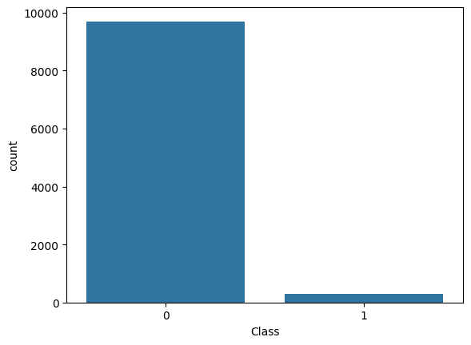
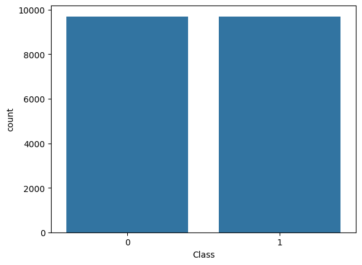
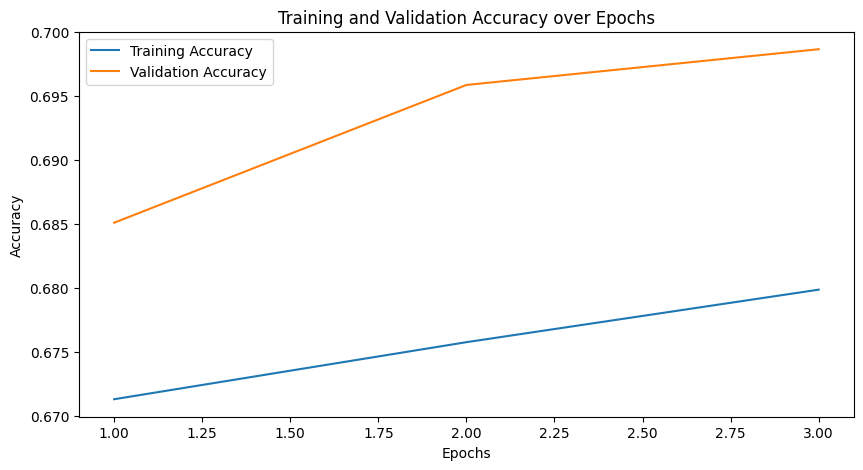

# 01 · Optimizers & Imbalanced Learning

> Mathematical intuition behind deep-learning optimizers, handling class imbalance with SMOTE,
> and a deep neural network for 3-class classification on a 111k-sample tabular dataset.

**Notebook:** [`optimizers_smote_dnn.ipynb`](optimizers_smote_dnn.ipynb) · **Assignment:** [`assignment.pdf`](assignment.pdf)

## What's inside

### 1. How the optimizers work
Update rules derived and explained for:
- **SGD + Momentum**: an exponentially weighted velocity term smooths updates and helps the optimizer roll past shallow local minima.
- **AdaGrad**: a per-parameter learning rate scaled by the accumulated squared gradients. It suits sparse features, but the learning rate shrinks over time.
- **RMSprop**: replaces AdaGrad's running sum with an exponential moving average, which stops the learning rate from decaying too far.

### 2. Comparison from the literature
Strengths, weaknesses and typical use cases for each optimizer when training neural networks.

### 3. SMOTE (Synthetic Minority Oversampling)
- How SMOTE works: it interpolates between a minority-class sample and one of its k nearest neighbours.
- A synthetic **3:97 imbalanced** dataset, rebalanced with SMOTE and used to train a TensorFlow model on both versions.

| Before SMOTE | After SMOTE |
|:---:|:---:|
|  |  |

### 4. Deep neural network: AdaGrad vs. RMSprop
- **Data:** about 111,000 samples × 92 anonymized features, 3 target classes (in [`data/`](data)).
- **Pipeline:** drop empty columns → `StandardScaler` → SMOTE → shuffled train / validation / test split.
- **Model:** dense network with BatchNorm and Dropout, softmax output, categorical cross-entropy loss.

| Optimizer | Test accuracy | Test loss |
|-----------|:---:|:---:|
| AdaGrad (lr = 1e-3) | 57.8% | 0.883 |
| **RMSprop** (lr = 1e-3, ρ = 0.98) | **70.3%** | **0.646** |

**Takeaway:** with the same model and training budget, RMSprop converges much faster than AdaGrad, whose learning rate decays too aggressively.

## Tech
TensorFlow / Keras · scikit-learn · imbalanced-learn · pandas · seaborn
