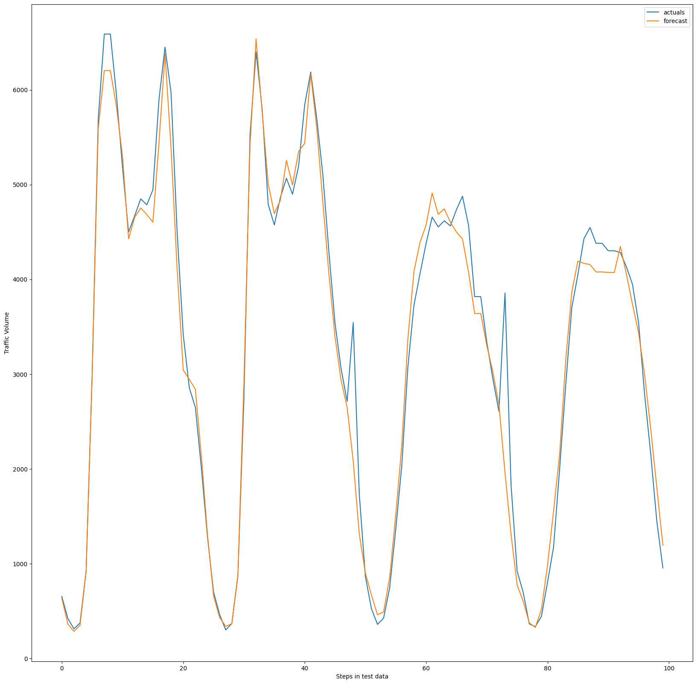
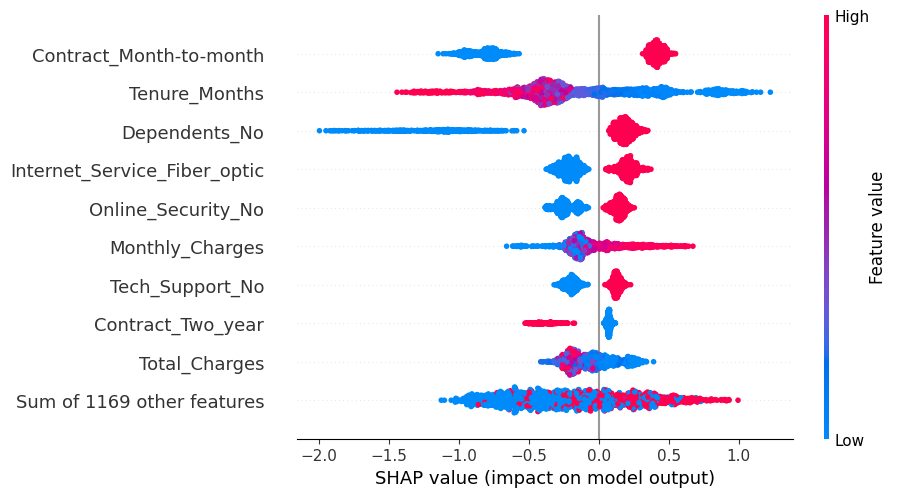

# 02 · Classical ML: KNN, SVM, Gradient Boosting & XGBoost

> Four foundational supervised-learning algorithms. Each one gets the theory, a numerical example
> worked by hand, and an end-to-end implementation on a real dataset.

**Notebook:** [`knn_svm_gbt_xgboost.ipynb`](knn_svm_gbt_xgboost.ipynb) · **Assignment:** [`assignment.pdf`](assignment.pdf)

The course supplied a reference notebook. I extended it with derivations, step-by-step numerical
examples for every algorithm (including an RBF-kernel SVM) and explanations of each code block.

## Part I: K-Nearest Neighbors
- Euclidean distance, plain vs. distance-weighted averaging, and how the choice of *k* matters. Includes a hand-worked classification example.
- **KNN regression for traffic forecasting** (Metro Interstate Traffic Volume) using engineered seasonality features (year, month, weekday, hour, holiday). **R² = 0.97** on the held-out steps.

## Part II: Support Vector Machines
- Maximum-margin intuition, the hard-margin formulation, soft margins with slack variables, the **Lagrangian dual**, and the kernel trick.
- A hand-solved hard-margin example, plus a **step-by-step RBF kernel example**, including the effect of γ on the decision boundary.
- Why feature scaling matters: on an experiment where one feature is scaled ×100, accuracy goes from **78.5% to 80.6%** once the features are standardized.
- Applications: Iris (100% test accuracy) and Titanic survival with an RBF SVM (**80.45%**).

## Part III: Gradient-Boosted Trees
- How boosting fits each new tree to the residuals of the previous ones, illustrated with worked slides.
- `GradientBoostingRegressor` on Boston housing, using staged predictions to choose the number of estimators. **MAE = 2.70**.

## Part IV: XGBoost
- Regularized objective, sparsity-aware handling of missing values, parallel tree construction, and cache-aware blocks.
- A worked example in the style of StatQuest (residuals → similarity scores → gain → output values).
- **Telco customer churn:** one-hot encoding, a stratified split, `GridSearchCV` over depth / learning rate / γ / λ / `scale_pos_weight`, a confusion matrix, and **SHAP** explanations.

**Insight from SHAP:** month-to-month contracts, short tenure and fiber-optic internet are the strongest predictors of churn.

## Data sources
Metro Interstate Traffic Volume (UCI) · Titanic (Kaggle) · Telco Customer Churn (IBM sample) · Boston Housing (OpenML) · Iris (scikit-learn). These datasets are not included in the repo.

## Tech
scikit-learn · XGBoost · SHAP · pandas · matplotlib
