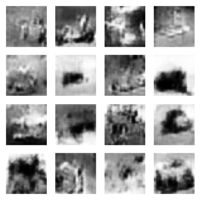
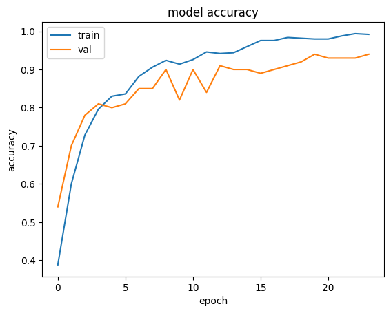

# 03 · CNNs, GANs & Transfer Learning

> Medical image classification with pretrained CNNs, a Deep Convolutional GAN on CIFAR-10,
> and transfer-learning strategies for small datasets.

**Assignment:** [`assignment.pdf`](assignment.pdf)

| Notebook | Topic |
|---|---|
| [`1_skin_lesion_classification_vgg16_resnet50.ipynb`](1_skin_lesion_classification_vgg16_resnet50.ipynb) | VGG16 vs. ResNet50 for skin-lesion classification, with and without augmentation |
| [`2_dcgan_cifar10.ipynb`](2_dcgan_cifar10.ipynb) | DCGAN on CIFAR-10, and why the non-saturating generator loss works better |
| [`3_transfer_learning_small_datasets.ipynb`](3_transfer_learning_small_datasets.ipynb) | Transfer learning when the target data is small and either *different from* or *similar to* ImageNet |

## Part I: Skin-lesion classification (Melanoma · Nevus · Carcinoma)
- Dermoscopy images from the ISIC archive, in [`data/skin-lesions/`](data/skin-lesions).
- ImageNet-pretrained **VGG16** and **ResNet50** backbones with a new classification head. **Four models** were trained: each backbone with and without augmentation (rotation, shift, shear, zoom, horizontal flip).
- Covers both architectures (VGG's stacked 3×3 convolutions vs. ResNet's residual connections) and the pros and cons of data augmentation.
- With only about 140 images, VGG16 reached **80% validation accuracy** without augmentation. On a dataset this small, augmentation acted as heavy regularization and slowed convergence within 20 epochs. This trade-off is discussed in the notebook.

## Part II: Deep Convolutional GAN
- Generator: a Dense layer → reshape → `Conv2DTranspose` stack with BatchNorm and LeakyReLU. Discriminator: a strided CNN with Dropout.
- Custom training loop using `tf.GradientTape`, Adam (1e-4), trained for 300 epochs on CIFAR-10.
- **Gradient ascent vs. descent for the generator:** `log(1 − D(G(z)))` saturates when the discriminator is confident, which makes its gradients vanish early in training. Maximizing `log D(G(z))` instead gives strong gradients in exactly that phase. The notebook demonstrates this with a numerical example.

## Part III: Transfer learning on small datasets

| Scenario | Dataset | Strategy | Result |
|---|---|---|---|
| Small and **different** from ImageNet | MNIST (400 training images) | Frozen VGG16 features with a new dense head; grayscale images converted to 3 channels | **94% validation accuracy** |
| Small and **similar** to ImageNet | CIFAR-10 (500 training images, 1% of the set) | Feature extraction: frozen VGG16 + GlobalAveragePooling + softmax head | 54% validation accuracy on 10 classes |

## Tech
TensorFlow / Keras · KerasCV · scikit-learn · NumPy · matplotlib
