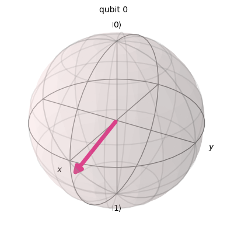

# 04 · Clustering, Decision Trees & Quantum ML

> Unsupervised investor segmentation, the math behind tree-splitting criteria, tree ensembles for
> classification and regression, and encoding classical data into quantum states with Qiskit.

**Notebook:** [`clustering_trees_quantum.ipynb`](clustering_trees_quantum.ipynb) · **Assignment:** [`assignment.pdf`](assignment.pdf)

## Part I: Unsupervised learning
- **How the methods work:** agglomerative hierarchical clustering (single, complete, average and Ward linkage), and DBSCAN (core, border and noise points, ε and MinPts). Each comes with a worked example. The hand-computed DBSCAN result is checked against scikit-learn.
- **Investor segmentation:** investors are grouped by age, education, income, net worth, risk tolerance, life cycle and other survey features, so that portfolio managers can standardize allocation per cluster. The data is [`data/people_info.csv`](data/people_info.csv). K-Means uses the elbow method to choose *k*.

| Algorithm | Silhouette score |
|---|:---:|
| K-Means | 0.278 |
| Hierarchical (agglomerative) | 0.192 |
| **DBSCAN** | **0.434** |

## Part II: Decision trees & random forests
- **Gini impurity**, derived and computed by hand, then verified in code on a toy dataset.
- **Gini vs. entropy:** an example showing that entropy tends to produce more balanced trees, while Gini tends to put the most frequent class in its own branch.
- **Classification** on a 111k-sample, 3-class dataset. Random Forest scored **70%** accuracy vs. **67%** for a single Decision Tree, with higher F1 on every class.
- **Regression:** how trees split on MSE, then the Boston Housing data with outlier analysis and median imputation.

| Model | Test MSE (Boston Housing) |
|---|:---:|
| Decision Tree Regressor | 12.80 |
| **Random Forest Regressor** | **7.84** |

## Part III: Quantum computing (Qiskit)
- **Basis encoding:** a binary string is mapped onto computational basis states with X gates. For example, `100` becomes |001⟩ (state vector checked).
- **Amplitude encoding:** a normalized classical vector is loaded into the state amplitudes. For example, [4, 5] becomes 0.625|0⟩ + 0.781|1⟩, visualized on the Bloch sphere.
- **Circuit analysis:** a given multi-qubit circuit (H, X, measurement) is explained and rebuilt in Qiskit.

## Tech
scikit-learn · SciPy · Qiskit / Qiskit Aer · pandas · matplotlib
