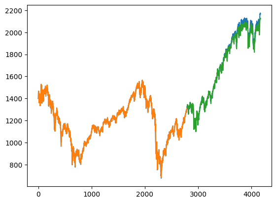

# 05 · Reinforcement Learning, RNNs & Search

> Policy iteration and Deep Q-Learning, a FrozenLake agent, LSTM math including full
> backpropagation by hand, tuned GRU/LSTM forecasters, and classical search algorithms.

**Assignment:** [`assignment.pdf`](assignment.pdf)

| Notebook | Topic |
|---|---|
| [`rl_lstm_search_algorithms.ipynb`](rl_lstm_search_algorithms.ipynb) | Policy iteration, the DQN walkthrough, FrozenLake, LSTM math, and search algorithms |
| [`deep_q_learning_cartpole.ipynb`](deep_q_learning_cartpole.ipynb) | Deep Q-Network on CartPole with KerasTuner hyperparameter search |
| [`rnn_gru_lstm_forecasting.ipynb`](rnn_gru_lstm_forecasting.ipynb) | SimpleRNN / GRU / LSTM time-series forecasting, tuned |

## Part I: Reinforcement learning
- **Policy iteration**, worked step by step on a grid world: evaluate the current policy, improve it greedily, and repeat until the policy stops changing.
- **Deep Q-Learning (CartPole):** line-by-line explanation of experience replay, the ε-greedy policy and the Bellman target. A **KerasTuner** search over network depth, layer widths, activation function and learning rate raised the average score from **32 to 100**, comparing the worst and best trials.
- **FrozenLake:** a Q-learning agent learns a safe path from **S** to **G** on the 4×4 grid and reaches a **100% success rate** over 100 evaluation episodes.

## Part II: RNNs and LSTMs
- Why plain RNNs struggle (vanishing and exploding gradients) and how LSTM gates (**forget, input, output**) and the cell state solve it.
- **Forward and backward propagation through an LSTM, done by hand**, with numbers for two time steps.
- **Improving the course-provided models with hyperparameter tuning:**

| Task | Metric | Course baseline | Tuned (mine) |
|---|---|:---:|:---:|
| Jena climate: temperature forecasting | R² | 0.778 (SimpleRNN) | **0.932** (GRU) |
| S&P 500: LSTM forecasting | Test RMSE | 46.19 | **24.51** |

Orange: training fit · Green: test-set predictions · Blue: actual price

## Part III: Search algorithms
- **A\*** search: two hand-traced examples, each with a Python implementation (f = g + h).
- **Minimax**: one example without pruning and one with **alpha-beta pruning**.
- **Uninformed search**: DFS, BFS and Uniform-Cost Search, each traced by hand and implemented.
- **Constraint satisfaction**: four-colouring a map by traversing its region graph so that no two adjacent regions share a colour.

## Data
[`data/jena_climate_2009_2016.csv`](data) (Max Planck Institute weather station) · [`data/sp500.csv`](data)

## Tech
TensorFlow / Keras · KerasTuner · OpenAI Gym · NumPy · pandas · matplotlib
