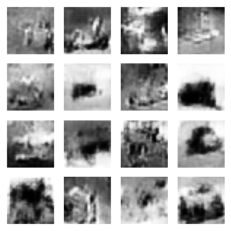
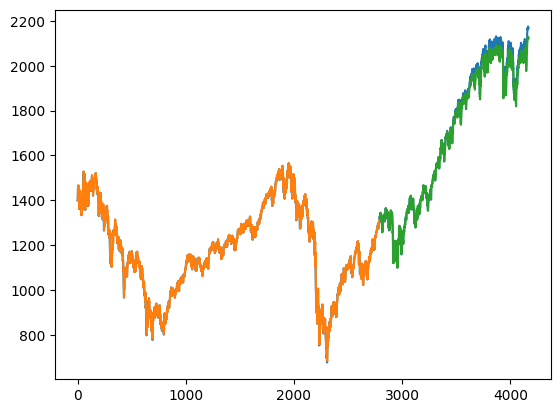
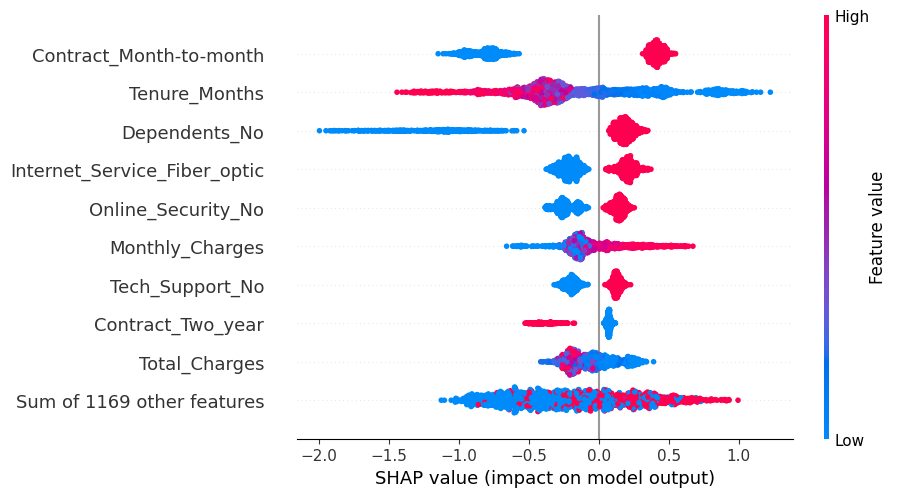

<div align="center">

# Artificial Intelligence — Course Projects

**University of Tehran · School of Electrical & Computer Engineering · Spring 2024**
Instructor: Dr. Khoshnevisan

Five hands-on projects covering the breadth of modern AI: from optimizer math and classical ML,
through CNNs, GANs and transfer learning, to reinforcement learning, sequence models, search
algorithms and quantum machine learning.


</div>

---

## Projects at a glance

| # | Project | Topics | Highlights |
|---|---------|--------|------------|
| 01 | [**Optimizers & Imbalanced Learning**](01-optimizers-and-imbalanced-learning) | SGD + Momentum, AdaGrad, RMSprop, SMOTE, deep neural networks | Built a 3-class DNN on **111k samples × 92 features**. RMSprop reached **70.3% test accuracy**, vs. 57.8% for AdaGrad, under the same budget |
| 02 | [**Classical ML: KNN, SVM, Boosting**](02-classical-ml-knn-svm-boosting) | KNN regression, hard/soft-margin and RBF-kernel SVM, Gradient-Boosted Trees, XGBoost, SHAP | KNN traffic forecast with **R² = 0.97**; XGBoost churn model tuned with GridSearchCV and explained with SHAP |
| 03 | [**CNNs, GANs & Transfer Learning**](03-cnn-gan-transfer-learning) | VGG16, ResNet50, data augmentation, DCGAN, transfer-learning strategies | Skin-lesion classification (Melanoma / Nevus / Carcinoma), a DCGAN trained on CIFAR-10, and **94% accuracy on MNIST from only 400 images** using a frozen VGG16 |
| 04 | [**Clustering, Trees & Quantum ML**](04-clustering-decision-trees-quantum-ml) | K-Means, Hierarchical, DBSCAN, Gini vs. entropy, Decision Tree and Random Forest, Qiskit data encoding | Investor segmentation (DBSCAN silhouette **0.43**); Random Forest cut Boston-housing MSE from **12.8 to 7.8**; basis and amplitude encoding in Qiskit |
| 05 | [**Reinforcement Learning, RNNs & Search**](05-reinforcement-learning-rnn-search) | Policy iteration, Deep Q-Learning, Q-Learning, LSTM math and backprop, GRU/LSTM forecasting, A*, Minimax, BFS/DFS/UCS, CSP | FrozenLake agent with a **100% success rate**; hyperparameter tuning cut S&P 500 LSTM test RMSE from **46.19 to 24.51** and raised temperature-forecast R² from **0.78 to 0.93** |

<p align="center">
  
  
  
</p>
<p align="center"><sub>Left to right: DCGAN-generated CIFAR-10 images · tuned LSTM forecasting the S&P 500 · SHAP feature attributions for the XGBoost churn model</sub></p>

---

## Skills demonstrated

- **Deep learning:** dense networks, CNNs (VGG16, ResNet50), GANs, RNN / GRU / LSTM, batch norm, dropout, early stopping
- **Classical ML:** KNN, SVM (including kernel methods and the dual form), decision trees, random forests, gradient boosting, XGBoost
- **Unsupervised learning:** K-Means, agglomerative clustering, DBSCAN, silhouette analysis
- **Reinforcement learning:** MDPs, value and policy iteration, tabular Q-learning, Deep Q-Networks
- **Search and planning:** A*, Minimax with alpha-beta pruning, BFS, DFS, UCS, constraint satisfaction
- **Model engineering:** hyperparameter tuning (KerasTuner, GridSearchCV), SMOTE for class imbalance, data augmentation, transfer learning, explainability with SHAP
- **Quantum computing:** basis and amplitude encoding, circuit construction and state-vector simulation in Qiskit
- **Math foundations:** each algorithm comes with a derivation and a worked numerical example done by hand, not only code

---

## Repository structure

```
.
├── 01-optimizers-and-imbalanced-learning/
├── 02-classical-ml-knn-svm-boosting/
├── 03-cnn-gan-transfer-learning/
├── 04-clustering-decision-trees-quantum-ml/
├── 05-reinforcement-learning-rnn-search/
│   ├── README.md          # overview, approach, results
│   ├── assignment.pdf     # original problem statement
│   ├── *.ipynb            # notebooks (outputs included)
│   ├── data/              # datasets used (where redistributable)
│   └── assets/            # figures used in the README
├── requirements.txt
└── LICENSE
```

## Running the notebooks

The notebooks were developed in **Google Colab** and are saved **with their outputs**, so you can read
the results on GitHub without running anything. To run them locally:

```bash
git clone https://github.com/behradbina/AI-Projects.git
cd AI-Projects
pip install -r requirements.txt
jupyter lab
```

> Some cells load data or slide images from the Google Drive path used during the course
> (e.g. `/content/drive/MyDrive/...`). Point those paths to the files in the project's `data/` folder.
> A few external datasets (Metro traffic, Telco churn, Titanic) are not included; their sources are
> listed in each project's README.

## Author

**Behrad Binaei Haghighi** · University of Tehran

## License

[GPL-3.0](LICENSE)
